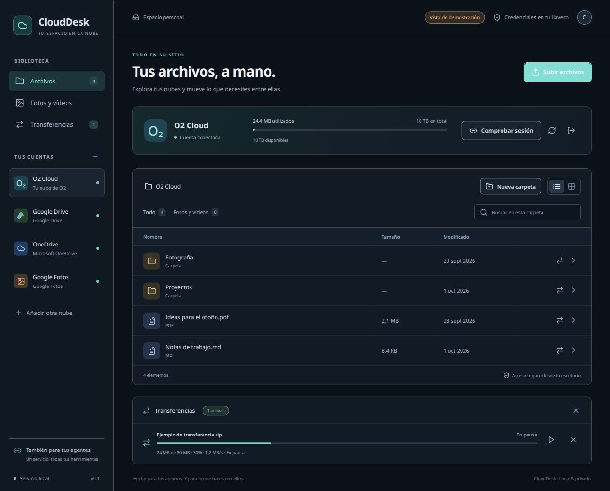

# CloudDesk

**O2 Cloud desde el escritorio y desde tus agentes de IA, con la misma sesión y cola de transferencias.**

Aplicación experimental para Linux: Rust/Tauri 2, React, React Native Web,
Tailwind CSS 2 y un servicio Python. O2 utiliza un adaptador comunitario de su
API interna; Drive, OneDrive y Google Fotos se conectan mediante rclone.
Proyecto independiente, sin afiliación con los proveedores.



La captura muestra la interfaz real en modo demostración. Los indicadores de
cuentas y los archivos son ficticios; no prueban acceso a Google o Microsoft.

## Qué puedes hacer

- Listar archivos y carpetas, consultar metadata y cuota, crear carpetas,
  subir, descargar, mover, renombrar y enviar a la papelera donde el proveedor lo permite.
- Buscar dentro de la carpeta, alternar lista/cuadrícula y archivos/fotos,
  previsualizar imágenes y abrir otros formatos con el visor del escritorio.
- Consultar bytes, porcentaje, velocidad media, duración y ETA orientativa.
- Pausar y reanudar descargas con validación del origen y del soporte Range.
- Copiar archivos/carpetas entre nubes; mover archivos verificando SHA-256
  antes de enviar el original a la papelera. Requiere espacio y tráfico local.
- Usar las mismas operaciones desde clientes compatibles con MCP stdio.

## Instalación desde el código fuente

Entrega verificada en **Linux x86_64**, con Python >=3.12, uv, Node/npm,
Rust/Cargo, curl, unzip, GTK 3, WebKitGTK 4.1 y un llavero Secret Service
disponible en la sesión de escritorio. Instala los requisitos de Tauri según
tu distribución: [documentación oficial](https://v2.tauri.app/start/prerequisites/).
Windows, macOS, ARM y una app móvil nativa quedan pendientes.

```bash
git clone https://github.com/calinrus-dev/clouddesk.git
cd clouddesk
./scripts/setup.sh
./scripts/start.sh
```

El setup descarga rclone oficial y valida sus checksums, instala las dependencias
fijadas en los lockfiles, Chromium para el acceso interactivo y compila el
ejecutable Linux de desarrollo en `bin/clouddesk`. Conserva la carpeta del proyecto:
la aplicación necesita el puente Python, su `.venv` y rclone. Esta entrega de
fuente no incluye un instalador autónomo ni binarios precompilados.

Para explorar solo la interfaz:

```bash
npm ci
npm run dev
```

La vista de navegador es una demostración con datos ficticios. Las operaciones
con cuentas reales requieren Tauri.

## Conectar las cuentas

**O2:** pulsa «Conectar O2» y completa el acceso en la página oficial que abre
Chromium. La sesión se valida antes de guardarse en el llavero Secret Service.
No se importan cookies del navegador de Codex ni se guarda un perfil persistente.
Si caduca y no puede renovarse, vuelve a conectar desde la interfaz.

**Drive y OneDrive:** pulsa «Añadir otra nube» o ejecuta
`./scripts/configure-clouds.sh`. En rclone elige `n`, asigna un nombre y selecciona
`drive` o `onedrive`. Completa OAuth en el navegador y actualiza las cuentas.
La configuración se cifra y la contraseña aleatoria se guarda en el llavero;
no la cambies ni la quites desde el asistente. «Configurada» no garantiza que
el acceso OAuth siga vigente: el listado comprueba el acceso efectivo.

**Google Fotos:** necesita un client ID propio. Su API limita el acceso al
contenido creado mediante la integración y no permite borrar fotos de la
biblioteca. CloudDesk bloquea sus movimientos y borrados. Consulta las
[restricciones y configuración de rclone](https://rclone.org/googlephotos/).

No introduzcas contraseñas, cookies ni tokens en conversaciones con agentes.

## Agentes mediante MCP

Registra la ruta absoluta del servidor en cada cliente compatible:

```bash
codex mcp add clouddesk -- "/ruta/absoluta/clouddesk/scripts/mcp.sh"
```

Para otros clientes adapta [docs/mcp-clients.json](docs/mcp-clients.json).
Empieza por `cloud_accounts`: los identificadores son `o2` y `rclone:NOMBRE`.
Las herramientas genéricas incluyen `cloud_list`, `cloud_stat`, `cloud_quota`,
`cloud_mkdir`, `cloud_move`, `cloud_delete`, `cloud_upload`, `cloud_download`,
`cloud_copy`, `cloud_jobs`, `cloud_pause`, `cloud_resume` y `cloud_cancel`.
Las transferencias devuelven un trabajo; consulta `cloud_jobs` para seguirlo.
También existen alias `o2_*`. El login se completa desde la interfaz.

La GUI y los agentes comparten el mismo servicio local. Configurar MCP permite
al agente realizar las operaciones de archivos expuestas sobre tus cuentas:
añádelo solo a clientes de confianza y usa sus controles de autorización.
La aplicación no configura automáticamente todos tus agentes.

## Estado y protecciones

Sesiones O2 y contraseñas: llavero Secret Service, sin fallback en texto plano.
Estado operativo: `$XDG_STATE_HOME/clouddesk` o `~/.local/state/clouddesk`.
La configuración rclone está cifrada; historial, parciales y logs tienen
permisos privados. El historial contiene rutas y metadata: no lo publiques.

El servicio escucha en `127.0.0.1:47823`, exige token del llavero y rechaza
peticiones con `Origin`. El frontend usa comandos Tauri y no recibe ese token.
Las cookies O2 no se transmiten a CDN externos. Esto no protege frente a
procesos maliciosos con acceso a tu sesión local o llavero desbloqueado.

| Variable | Uso |
|---|---|
| `O2_DESKTOP_ROOT` | Ruta del código para Tauri; el lanzador la configura. |
| `O2_DESKTOP_STATE_DIR` | Directorio de estado alternativo, idéntico para GUI y MCP. |
| `XDG_STATE_HOME` | Base del estado por defecto. |
| `O2_DESKTOP_LOCAL_ROOTS` | Raíces locales adicionales, separadas por `:`. |

Las raíces por defecto son `Documents`, `Downloads`, `Pictures` y `Desktop`
del usuario. Si tu distribución usa nombres localizados, añade sus rutas
absolutas en `O2_DESKTOP_LOCAL_ROOTS` antes de iniciar GUI y MCP.
No se sobrescriben destinos existentes ni se modifica la raíz remota.

## Límites y validación

O2 usa una **API no oficial** que puede cambiar. Las subidas O2 y copias entre
nubes solo admiten cancelación; no pausa ni reanudación tras reiniciar.
Las subidas rclone se pausan mientras el proceso sigue activo. Cancelar no
revierte elementos ya copiados y un fallo puede dejar una copia en destino.
Ante una escritura fallida, consulta el listado antes de repetirla.

En la implementación original se validaron operaciones reales O2 con archivos
sintéticos: listado, cuota, creación, subida, descarga y checksum, Range,
renombrado, movimiento, papelera y sesión tras reiniciar. rclone se probó contra
un remoto local. **Drive, OneDrive y Fotos no se han validado con cuentas reales.**
La evidencia anterior está en [docs/VALIDATION.json](docs/VALIDATION.json);
las verificaciones de esta entrega, en [docs/RELEASE-VALIDATION.md](docs/RELEASE-VALIDATION.md).

```bash
uv run ruff check bridge tests
uv run pytest -q
npm run build
cargo test --manifest-path src-tauri/Cargo.toml --all-targets -j 2
```

## Contribuir y créditos

Se agradecen pruebas reproducibles en otras distribuciones, validación de
proveedores, mejoras de instalación y accesibilidad. Describe versión, operación,
resultado esperado y obtenido; elimina rutas personales, tokens y datos de cuentas
de cualquier captura o log. No publiques vulnerabilidades con secretos en issues.

Se reutiliza [garanda21/o2cloud_gateway_webdav](https://github.com/garanda21/o2cloud_gateway_webdav),
MIT, fijado al commit `995756d4f36e97981f27045fc631b509cf8612b9`.
Se conserva su [licencia](docs/LICENSE-o2gateway.txt). No se ejecuta su servidor WebDAV.
rclone también usa licencia MIT y se descarga por separado. Consulta
[la investigación y arquitectura](docs/RESEARCH.md) y [las atribuciones](THIRD_PARTY.md).

Código propio de CloudDesk bajo [licencia MIT](LICENSE).
