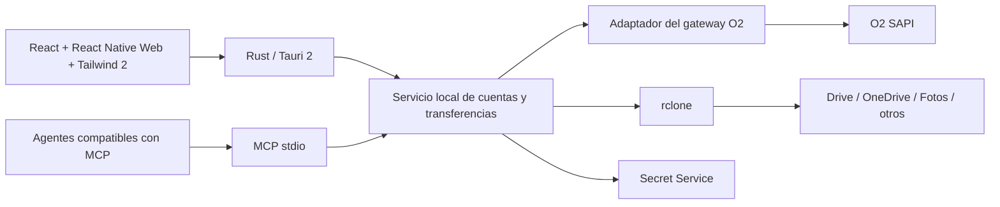

# Investigación y arquitectura — 1 de octubre de 2026

Se creó CloudDesk como proyecto independiente. La integración no modifica código de otra aplicación ni el ejecutable de Codex. Esta investigación describe la implementación original del 1 de octubre de 2026. La entrega pública distribuye fuente y descarga rclone por separado; véase README.md para instalación portable y validación de la entrega.

## Evidencia sobre O2

Se descargaron el HTML y el JavaScript publicados por [cloud.o2online.es](https://cloud.o2online.es/). Se inspeccionó el acceso y la pantalla de carpetas en la sesión ya abierta del navegador integrado, sin extraer credenciales. Una petición no autenticada devolvió 401. El bundle actual contiene las operaciones SAPI siguientes; se contrastaron con el código de proyectos públicos:

| Operación | Evidencia en la aplicación publicada / proyecto reutilizado |
|---|---|
| Raíz | `media/folder/root?action=get` bajo `/sapi/` |
| Carpetas | `media/folder` con acciones `list`, `save`, `softdelete` |
| Metadata y cuota | `media`, incluyendo `get-storage-space` y `softdeleted=true` |
| Subida | Dominio `upload.cloud.o2online.es`, `upload/<tipo>?action=save-metadata`, campos multipart `data` JSON y `file`; metadata `folderid` |
| Procesamiento de subidas grandes | Parámetro `acceptasynchronous` |
| Acceso | Callback `https://cloud.o2online.es/sapi/login/oauth`; el cliente público reutiliza `JSESSIONID` y `validationKey` |

Son hallazgos de código publicado, no una validación completa de todas las peticiones autenticadas. No se han deducido ni añadido endpoints propios de O2. El código de CloudDesk delega el protocolo, incluyendo movimiento, descarga firmada y validación posterior a subida, en un adaptador existente fijado a un commit. Una futura modificación de O2 puede exigir actualizarlo. Tras conectar la cuenta del usuario, se verificaron las operaciones de archivos con datos sintéticos y la reutilización de sesión después de reiniciar el servicio. La captura inicial del CLI solo con cookies falló; la captura final observa el validationKey usado por SAPI, los headers de dispositivo y el User-Agent, además de OAuth si se devuelve. La sesión finalmente validada no incluía OAuth renovable, por lo que puede necesitar acceso interactivo al caducar. No se aisló una única causa del rechazo inicial.

## Proyectos evaluados

1. [danielperez9430/o2cloud-cli](https://github.com/danielperez9430/o2cloud-cli), Rust, commit `bb95c9d25fa0633d7b12336f02f4175f22c6429b`: útil como referencia; persiste autenticación en `auth.json` y no cubre todas las operaciones de movimiento requeridas. No se ejecuta como backend.
2. [garanda21/o2cloud_gateway_webdav](https://github.com/garanda21/o2cloud_gateway_webdav), MIT, commit `995756d4f36e97981f27045fc631b509cf8612b9`: implementación de SAPI más completa y reutilizable. Se usan `O2CloudApiClient`, `O2CloudFileStore` y sus modelos. Se sustituyen persistencia de sesión, cache y transporte. No se arranca su servidor WebDAV, panel administrativo, Docker ni navegador persistente.
3. [o2cloud 0.4.0 en PyPI](https://pypi.org/project/o2cloud/0.4.0/): se evaluó su acceso interactivo con navegador temporal, que devuelve las dos cookies de O2. En la prueba con la cuenta del usuario ese resultado fue rechazado; no se usa para el acceso final. El adaptador reutiliza los helpers de captura OAuth del gateway en un contexto temporal y valida la sesión antes de persistirla. Su implementación de movimiento no resuelve adecuadamente todos los casos de renombrado y no se usa para operaciones de archivos. SHA-256 del wheel inspeccionado: `ae27a6907f647eb71ec40e4d5bd28f2fc65fb42f144eb76cc028e3c82a0ae812`. El enlace de repositorio declarado por esa distribución no estaba accesible al consultarlo.
4. [rclone 1.75.1](https://github.com/rclone/rclone/releases/tag/v1.75.1): binario oficial Linux amd64, archivo de distribución contrastado con SHA256SUMS oficial: `982b5aa772841168f8e380f139e9e787b2a105403e32b94da8676a0e1c0a13ab`. La copia instalada tiene su checksum en `tools/rclone.sha256`.

El código de proyectos externos se incorpora como dependencias, no como una copia del protocolo. Las versiones transitivas están fijadas en `uv.lock`, `package-lock.json` y `src-tauri/Cargo.lock`; se conserva licencia del gateway en `docs/LICENSE-o2gateway.txt` ; rclone se descarga por separado desde su canal oficial.

## Arquitectura elegida

El contrato `Backend` utiliza las mismas operaciones y metadata para los proveedores. Permite sustituir el adaptador O2 por un cliente WebDAV, CLI u otra implementación sin modificar GUI y herramientas MCP. No se ha implementado un segundo adaptador O2 hipotético: añadir WebDAV ahora introduciría otro servidor y gestión de credenciales sin resolver las restricciones del protocolo subyacente. rclone ya permite añadir remotos WebDAV configurados por el usuario.

La lógica de sesión y cola se concentra en un único servicio compartido; cada agente mantiene su transporte MCP, pero no otra sesión O2. El historial persiste únicamente datos operativos. La cache de metadata SAPI, que puede incluir tokens de descarga en campos internos, permanece en memoria. El transporte impide mandar cookies de O2 a otros dominios y valida respuestas Range antes de anexar parciales.

Tailwind 2 trabaja en DOM; para usar componentes React Native en Tauri se incorpora [React Native Web](https://necolas.github.io/react-native-web/docs/). Esta entrega es de escritorio y emplea componentes web junto con primitivas RN Web; no crea una app iOS/Android independiente.

## Restricciones verificadas

- [Google Fotos en rclone](https://rclone.org/googlephotos/) y [cambios de Google](https://developers.google.com/photos/support/updates): a partir del 31/03/2025 las APIs dejaron de permitir el acceso general a la biblioteca. Acceso limitado a contenido creado por la integración, sin borrado de biblioteca; descarga con posibles pérdidas de metadata/resolución. El client ID compartido de rclone se está retirando: configurar uno propio.
- [Configuración cifrada de rclone](https://rclone.org/docs/#configuration-encryption) y [comando encryption set](https://rclone.org/commands/rclone_config_encryption_set/): ofuscar una contraseña con rclone no equivale a cifrar todo el archivo. CloudDesk exige el encabezado `RCLONE_ENCRYPT_V0` y usa contraseña de llavero.
- [rclone cat](https://rclone.org/commands/rclone_cat/): soporta `--offset`, utilizado para descargas reanudadas y probado con un remoto local real.
- [MCP en Codex](https://learn.chatgpt.com/docs/extend/mcp?surface=cli): configuración mediante `codex mcp add`; los agentes externos deben configurar su cliente compatible. No hay modificación interna de Codex ni extensión automática a clientes desconocidos.

La subida O2 puede quedar en validación asíncrona: el código comunica procesamiento y rechaza confirmaciones con ID pendiente. El gateway también implementa borrados diferidos cuando el proveedor está validando; una aceptación local no garantiza que la papelera se haya actualizado inmediatamente. Ante fallo o cancelación hay que consultar el listado antes de repetir escrituras.
